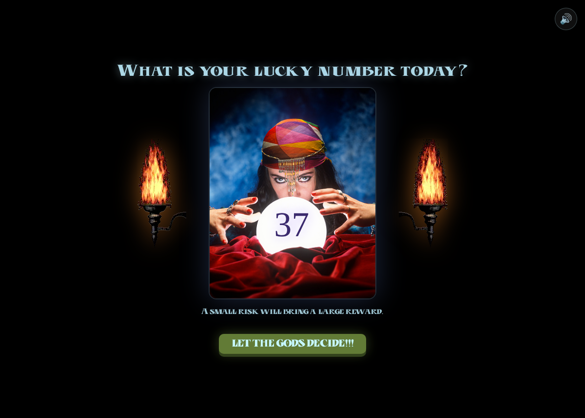

# 🔮 What is your lucky number today?

A tiny esoteric random number generator: ask the fortune teller and the gods pick your lucky number (0–99)
together with an omen. One of my first JavaScript projects (2022), refreshed in 2026 keeping its original look.

**Live demo:** https://patcont.github.io/Esoteric-random-number-generator

## Features

- The original fortune teller, torches and esoteric font from 2022
- The number appears glowing **inside the crystal ball** of the photo, which pulses while the gods decide
- Random omen with every number; uses `crypto.getRandomValues`
- Ritual music and crackling fire **synthesized live with the Web Audio API** (starts on the first click, mute button top-right)
- Responsive layout, keyboard accessible, *reduced-motion* friendly

## Run it

No build step: open `index.html` or serve the folder (`npx serve .`).
(The page uses ES modules, so some browsers need it served over `http://` instead of `file://`.)

## 2026 refresh

Same look as the 2022 version, with modern code: the number now lives inside the crystal ball, the layout
works on phones, the two YouTube-ripped MP3s were replaced by music generated in the browser, and the repo
dropped unused files. The original code is in the git history.
